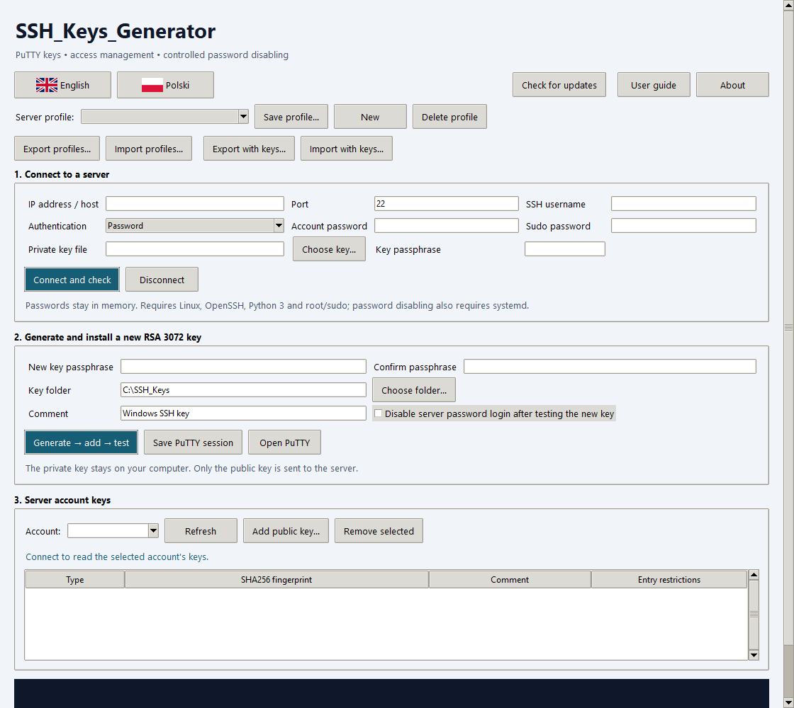

# SSH_Keys_Generator

A utility that makes it easier to set up SSH key authentication for logging in to a remote server.



The screenshot shows an empty form, with no real server details or credentials.

## Download and run

Download the Windows installer or portable executable from [Releases](https://github.com/adamzend/SSH_Keys_Generator/releases).
Windows 10/11 x64 is required. Python is not needed for the packaged application.
Installation is per user and does not need Windows administrator privileges.
PuTTY is optional; install it separately to use the **Open PuTTY** button.
The executables are not code-signed.

## Features

- Generate RSA 3072 keys as encrypted PuTTY PPK v3 and OpenSSH files, plus a public key.
- Install the public key on a Linux SSH account and verify an independent key-authenticated connection.
- Optionally disable SSH password authentication with configuration checks, a systemd rollback timer and a new connection test.
- List, add and remove supported `authorized_keys` entries, with server-side backups and checks against concurrent changes, removing the last key, or removing the active connection key.
- Save multiple named server profiles and create PuTTY sessions.
- Export/import profile settings as JSON, without passwords or key contents.
- Export/import profiles and their referenced private key files in a password-protected `.sshkg` bundle. Encryption uses AES-256-GCM with a scrypt-derived key. Import updates local key paths and uses access-restricted directories without overwriting existing keys.

## Updates

Click **Check for updates** in the main window. The application compares your version with the latest stable GitHub release and offers its installer (including re-downloading the current version). Downloads use HTTPS, validate the repository and redirect destinations, and verify file size and the GitHub-provided SHA256 digest before saving. Failed downloads do not overwrite an existing destination file.

Installation does not start automatically: finish your work, close the application and run the downloaded installer. Profiles and keys are preserved. Checks run only when requested, without sending server profiles, keys or credentials. GitHub receives a normal public release/download request; no login or token is required. SHA256 verification is an integrity check, not code signing.

## Quick start

1. Enter the host, port, username and password or private key details.
2. Click **Connect and check** and verify the server fingerprint against a trusted source.
3. Enter and confirm a new key passphrase, choose a key folder and click **Generate → add → test**.
4. Save a PuTTY session or select the resulting PPK file in PuTTY.
5. Save a named profile for reuse. Use **Export with keys…** and **Import with keys…** to transfer saved profiles and referenced private keys to another computer.

The bundle password is separate from existing SSH key passphrases. Existing key encryption is preserved, so original key passphrases remain necessary. Forgotten passwords cannot be recovered.

## Server requirements and boundaries

Server operations require Linux, OpenSSH, Python 3 and root/sudo access. Automatic password disabling also requires systemd. It affects **all SSH users on the server**, not email or website passwords. Unsupported or complex configurations, such as SSH `Match` sections, require manual administrator review. Keep access to a provider/recovery console and test on a non-production system first.

The key list covers supported files inside the account's home directory. SSH certificate authorities and `AuthorizedKeysCommand` are separate access sources. PPK private-key import supports RSA; use OpenSSH for other key types. The software has automated tests, but is not a certified security product.

## Privacy and data

This repository, screenshot and release packages contain **no real server profiles, private keys, credentials or user logs**. Tests generate temporary keys and use synthetic connection data.

Application data stays in `%LOCALAPPDATA%\SSH_Keys_Generator`. Passwords and passphrases are not saved to profiles or PuTTY sessions. The ordinary JSON export is unencrypted; the `.sshkg` bundle encrypts profiles and key contents. Neither export includes account passwords, sudo passwords or key passphrases. The program does not use AI, telemetry or paid APIs.

Server backups are stored under `/var/backups/ssh-keys-generator/` and `/var/lib/ssh-keys-generator/`. They are not automatically removed. Uninstallation preserves local keys, profiles, known hosts and PuTTY sessions.

## Documentation

- [User guide](GUIDE_EN.txt)
- [Instrukcja obsługi](INSTRUKCJA.txt)
- [Third-party license notices](THIRD_PARTY_LICENSES.txt)

## Build from source

Use Windows x64 and Python 3.14. In PowerShell:

```powershell
python -m venv .venv
.\.venv\Scripts\python.exe -m pip install -r requirements.txt
.\.venv\Scripts\python.exe -m pytest -q
.\build.ps1 -Python .\.venv\Scripts\python.exe -InnoCompiler 'C:\Program Files (x86)\Inno Setup 6\ISCC.exe'
```

Omit `-InnoCompiler` to build only the portable executable. The script embeds the documentation, license and standalone remote helper. Build outputs are excluded from Git; distribute them through GitHub Releases. Run `python app.py` to start from source.

Tests cover PPK interoperability, access safeguards, profiles, encrypted bundle tampering and rollback, Windows ACLs and the application interface. Local PuTTY integration tests are skipped when PuTTY is unavailable. Tests do not contact a production server. GUI tests run in separate processes to match the desktop application's lifecycle.

## Author and license

(C) Adam Wojcieszonek 2026  
Contact: [adam@eksploracja.org.pl](mailto:adam@eksploracja.org.pl)

Licensed under the **GNU General Public License v3.0**. See [LICENSE](LICENSE). Third-party components retain their own licenses; see [THIRD_PARTY_LICENSES.txt](THIRD_PARTY_LICENSES.txt).

## Opis

Program narzędziowy ułatwiający konfigurację logowania do zdalnego serwera za pomocą klucza SSH. Szczegóły: [instrukcja](INSTRUKCJA.txt).
